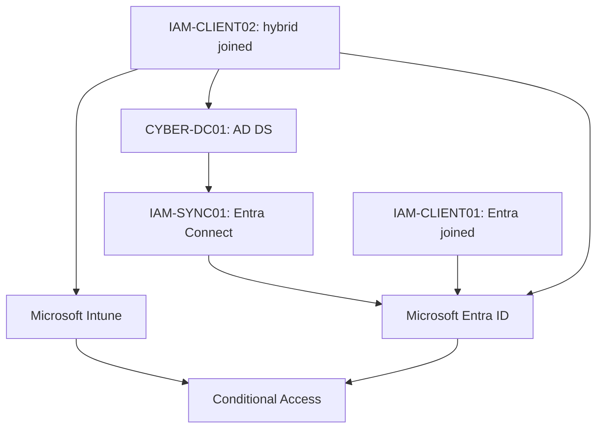
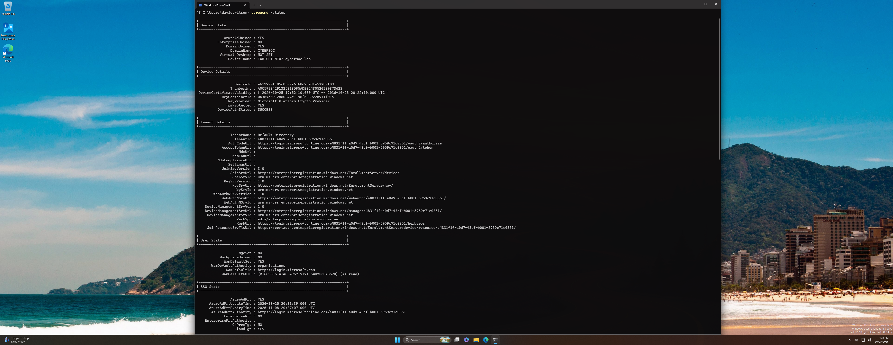
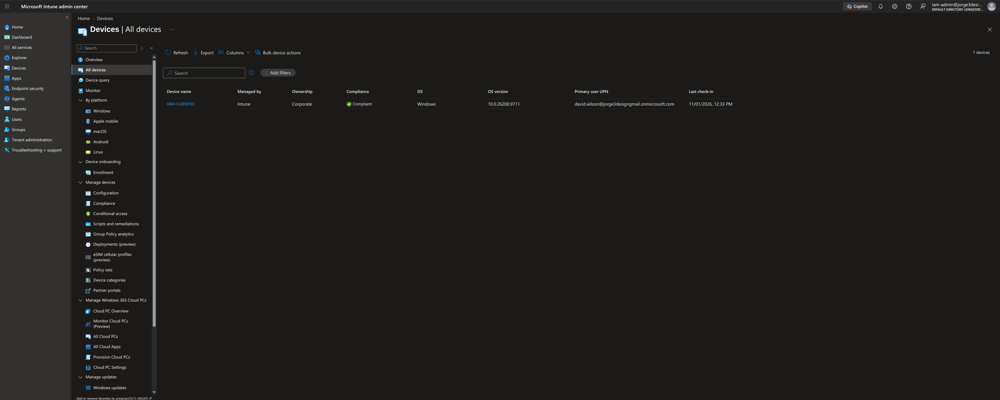
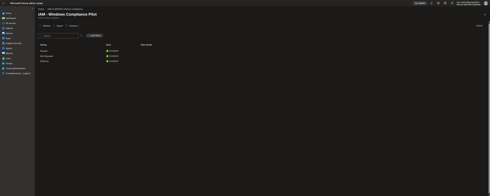
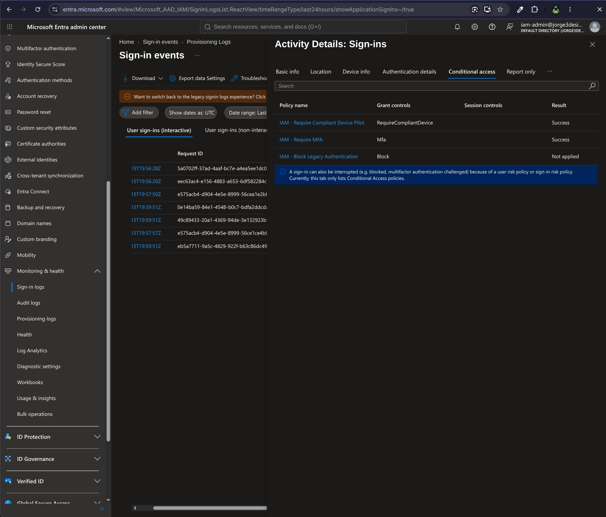
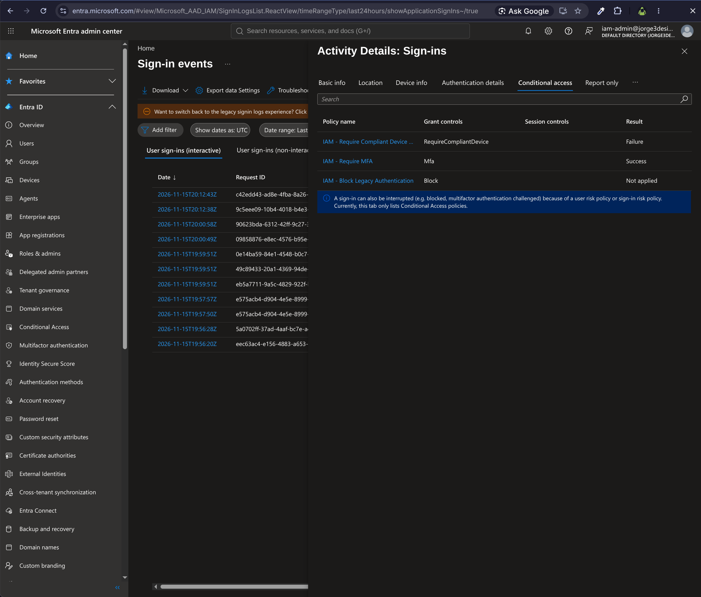
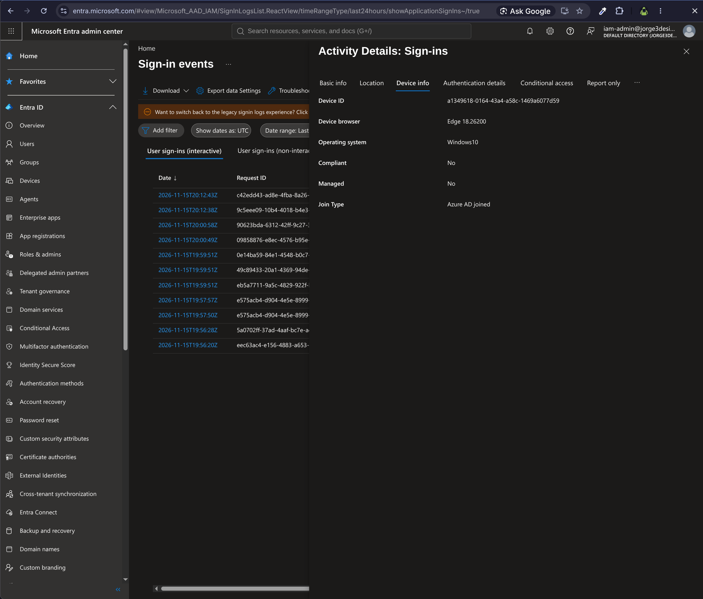

# IAM-Lab-Foundation

A practical identity and access management lab connecting Active Directory Domain Services, Microsoft Entra ID, and Microsoft Intune.

I built this environment to understand how user identity, device identity, management, and compliance affect access decisions. The final tests demonstrated that David Wilson could access a cloud resource from a compliant device, while access from an identified but unmanaged device was blocked even after successful MFA.

**Status:** Foundation implementation and device access validation completed on November 15, 2026.

## Objectives

1. Compare Microsoft Entra join with traditional AD domain join and hybrid join.
2. Synchronize a pilot identity using Microsoft Entra Connect Sync and password hash synchronization.
3. Verify Windows authentication and Primary Refresh Token (PRT) status.
4. Enroll a hybrid device into Intune through scoped automatic enrollment.
5. Evaluate device security using an Intune compliance policy.
6. Introduce Conditional Access through Report-only evaluation before enforcement.
7. Validate successful and denied access using sign-in logs and matching device IDs.

## Environment

The lab runs in VMware Workstation on an Arch Linux workstation. An existing AD domain was reused for the hybrid scenario.

| Component | Purpose | Configuration |
|---|---|---|
| CYBER-DC01 | AD DS and DNS | Windows Server 2022; domain `cybersoc.lab`; 192.168.100.10 |
| IAM-SYNC01 | Microsoft Entra Connect Sync | Windows Server 2022; password hash synchronization |
| IAM-CLIENT01 | Cloud device comparison | Windows 11; Microsoft Entra joined; not enrolled in Intune |
| IAM-CLIENT02 | Hybrid device pilot | Windows 11; AD domain joined, then hybrid joined and Intune enrolled; 192.168.100.50 |
| Ubuntu router | Outbound connectivity | Lab interface 192.168.100.1; separate VMware NAT interface |
| Microsoft Entra tenant | Cloud identity and access | Tenant domain `jorge3designgmail.onmicrosoft.com` |
| Microsoft Intune | Device management and compliance | Intune Plan 1 trial |

The local lab network uses VMnet2, 192.168.100.0/24. IAM-CLIENT02 uses the domain controller for DNS and the Ubuntu router as its default gateway.

The diagram separates identity synchronization, device management, and access evaluation. Arrows describe logical relationships rather than every network connection.



## Identities and administrative scope

| Identity or group | Purpose |
|---|---|
| Alex Morgan | Cloud identity used for Windows sign-in and MFA testing |
| David Wilson | AD identity synchronized to Entra; device compliance pilot user |
| iam-admin | Dedicated administrator with task specific directory roles |
| emergency-admin01 | Cloud emergency access account with a permanent active Global Administrator assignment |
| Finance-Team | Initial cloud security group |
| IAM-Intune-Pilot-Users | Assigned security group containing David; used for MDM enrollment scope, compliance assignment, and the device access pilot |

The dedicated administrator initially received User Administrator. Additional roles were assigned as required for hybrid identity, Intune, billing, and Conditional Access tasks. The account was not made Global Administrator for routine lab administration.

The emergency account was tested separately and excluded directly from the MFA and legacy authentication policies. It was outside the device pilot group.

## 1. Establish cloud identity and device baselines

I created the Entra tenant, configured the dedicated administrator, created Alex Morgan, and tested the difference between administrative and standard user capabilities.

On IAM-CLIENT01, I checked the Windows baseline, joined the device to Entra, and verified Alex's Windows sign-in and PRT status. Local Administrators membership was reviewed separately because directory roles and endpoint administrative membership are different controls.

Evidence: [01](Images/01-IAM-CLIENT01-baseline.png), [02](Images/02-Entra-tenant-overview.png), [03](Images/03-User-Administrator-assignment.png), [04](Images/04-Standard-user-create-user-disabled.png), [05](Images/05-IAM-CLIENT01-Entra-joined.png), [06](Images/06-Alex-Windows-signin-PRT.png), [07](Images/07-Local-administrators-membership.png).

## 2. Establish the AD device baseline

IAM-CLIENT02 was joined to `cybersoc.lab`. I verified the domain secure channel and captured its initial AD only state before introducing hybrid registration.

Outbound connectivity was provided through the Ubuntu router while retaining AD DNS resolution. This allowed the client to reach Microsoft services without replacing its domain DNS configuration.

Evidence: [08](Images/08-IAM-CLIENT02-domain-secure-channel.png), [09](Images/09-IAM-CLIENT02-AD-only-baseline.png), [10](Images/10-IAM-CLIENT02-outbound-connectivity.png).

## 3. Synchronize David and enable hybrid join

Microsoft Entra Connect Sync was installed on IAM-SYNC01 with password hash synchronization. OU filtering limited synchronization to the pilot scope.

I initially used staging mode to review synchronization before allowing exports. After checking the pilot, I disabled staging mode and verified that David appeared in Entra as a synchronized identity and could authenticate to cloud services using his AD credentials.

Hybrid device discovery was scoped through a pilot GPO. IAM-CLIENT02 was then verified as both AD domain joined and Entra joined. David's user session also showed a PRT.

Useful verification commands included:

```powershell
# Run in the signed-in user's session to inspect user and SSO state.
dsregcmd /status

# Verify the AD secure channel.
Test-ComputerSecureChannel

# Review applied computer policy.
gpresult /r /scope computer
```

The final hybrid validation included `DomainJoined: YES`, `AzureAdJoined: YES`, and `AzureAdPrt: YES`. These fields answer different questions: domain membership, cloud device registration, and the user's SSO token state.

Evidence: [11](Images/11-Entra-Connect-OU-filtering.png), [12](Images/12-David-Entra-synchronized.png), [13](Images/13-David-cloud-signin.png).



## 4. Enroll the hybrid device in Intune

I activated Entra ID P2 and Intune Plan 1 trials and assigned both to David. Alex and iam-admin later received Entra ID P2 for the broader Conditional Access policies. Intune remained assigned only to David.

Automatic enrollment was limited to `IAM-Intune-Pilot-Users` through the MDM user scope. A separate GPO, `IAM - Intune Auto Enrollment Pilot`, enabled automatic MDM enrollment using the default Entra credentials with **User Credential** selected. The GPO was scoped to IAM-CLIENT02.

Validation included applied Group Policy, MDM discovery information, the enrollment task, a successful Windows management sync, and the device record in Intune.

Evidence: [15](Images/15-IAM-CLIENT02-MDM-Sync.png).



## 5. Evaluate device compliance

The policy `IAM - Windows Compliance Pilot` was assigned to the pilot user group.

| Setting | Value |
|---|---|
| Platform | Windows 10 and later |
| Firewall | Require |
| Antivirus | Require |
| Antispyware | Require |
| Mark device noncompliant | Immediately |
| Other compliance settings | Not configured |

I verified that all three configured checks reported **Compliant**.

This policy evaluates security state. It does not itself configure the firewall or install antivirus. BitLocker, password, and TPM requirements were not configured in this compliance policy.



## 6. Prepare and enforce Conditional Access

I first created the device policy in **Report-only** and compared successful and unsuccessful evaluations. This allowed me to inspect policy behavior without enforcing the device requirement.

Evidence: [18: Report-only success](Images/18-Conditional-Access-ReportOnly-Success.png), [19: Report-only failure](Images/19-Conditional-Access-ReportOnly-Failure.png).

Before disabling Security defaults, I prepared replacement MFA and legacy authentication policies, checked MFA registration and sign-in results, and tested emergency account access.

Security defaults were then disabled, and the replacement policies were enabled. The device pilot was enabled after the baseline policies had been validated.

### Final policy configuration

| Policy | Users | Target resources | Control | Final state |
|---|---|---|---|---|
| IAM - Require MFA | All users; emergency account excluded | All resources | Grant access; require MFA | On |
| IAM - Block Legacy Authentication | All users; emergency account excluded | All resources | Block access for Exchange ActiveSync clients and Other clients | On |
| IAM - Require Compliant Device Pilot | IAM-Intune-Pilot-Users | All resources | Grant access; require device to be marked as compliant | On |

The device pilot excluded macOS, iOS, Android, and Linux through its device platform condition. Its enforcement tests were performed on Windows. The legacy policy left Browser and Mobile apps and desktop clients unselected.

**Scope matters:** the device policy targeted all resources for the pilot user group, rather than only Microsoft 365. The tested resource was My Account and its associated Microsoft Graph requests.

### Allowed access: IAM-CLIENT02

David signed in from his regular Edge work profile on the compliant hybrid device and completed MFA when prompted.

| Policy | Observed result |
|---|---|
| Require Compliant Device Pilot | Success |
| Require MFA | Success |
| Block Legacy Authentication | Not applied |



### Denied access: IAM-CLIENT01

David's sign-in from IAM-CLIENT01 satisfied MFA but failed the enforced device compliance requirement.

| Policy | Observed result |
|---|---|
| Require Compliant Device Pilot | Failure |
| Require MFA | Success |
| Block Legacy Authentication | Not applied |



The sign-in supplied a device ID that matched IAM-CLIENT01's Entra record. Device information showed **Managed: No**, **Compliant: No**, and an Entra join type. The directory record showed **MDM: None** and **Compliance: N/A**.

This was an identified device failing the compliance requirement, rather than a request with no device identity. Entra join alone did not satisfy the required compliance state.



## Troubleshooting and observations

| Observation | Investigation and action | Outcome |
|---|---|---|
| MDM discovery URLs were initially blank despite the pilot assignment | Checked licensing, MDM scope, applied GPO, and user token state; refreshed the PRT and completed a full sign-out and sign-in | MDM discovery information appeared and enrollment completed |
| Compliance reports initially contained no device results | Confirmed assignment and synchronization, then allowed time for evaluation and reporting | The policy appeared on IAM-CLIENT02 with all configured checks compliant |
| A Linux test showed Report-only: Not applied | Compared the request platform with the device policy's platform exclusions | The event was outside scope and was not evidence of a compliance denial |
| Alex showed Report-only: User action required | Checked registered Authenticator methods and later tested with MFA enforcement enabled | Enforced MFA succeeded |
| The original Global Administrator encountered AADSTS50079 after the MFA transition | Retried in a fresh sign-in session and completed the required MFA flow | Administrative access was restored |
| The denied Windows test contained a device ID | Matched the sign-in device ID to IAM-CLIENT01 in Entra | Confirmed the precise device involved in the failed compliance check |

## Results and boundaries

The completed lab demonstrates cloud and hybrid device identity, scoped user synchronization, automatic Intune enrollment, security compliance evaluation, and enforced access decisions.

1. The same pilot user satisfied MFA on both Windows devices.
2. The compliant hybrid device satisfied the device access requirement.
3. The unmanaged Entra joined device failed that requirement.
4. Sign-in logs and device records provided evidence for the access decision.

The legacy authentication policy was configured and enabled, but no actual legacy client blocking test was performed. Its **Not applied** result on modern browser requests is not proof that a legacy request was blocked.

This is a learning environment, not a production deployment. Only one emergency account was created, and it used Microsoft Authenticator. Independent emergency authentication, a second recovery account, alerting, advanced PIM workflows, and broader platform testing remain outside this project's completed scope.

The trial subscriptions showed December 1, 2026 as their renewal or expiration date during the final review. Recurring billing must be checked in subscription details; the product list alone does not establish that renewal is enabled. Continued use depends on valid licensing.

## Next phase

The next project will use this foundation for employee identity lifecycle scenarios: joining the organization, changing departments, and leaving the organization. The focus will be access assignment, access removal, automation, and audit verification.
